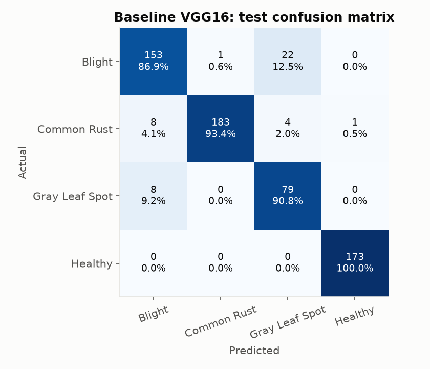
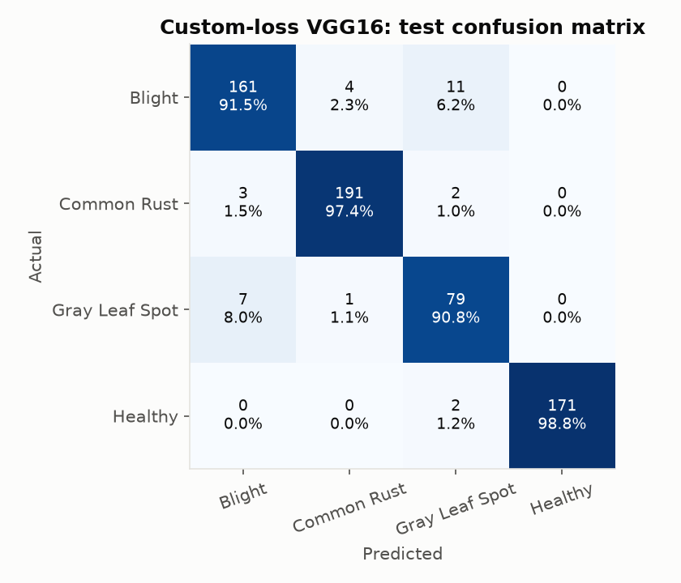
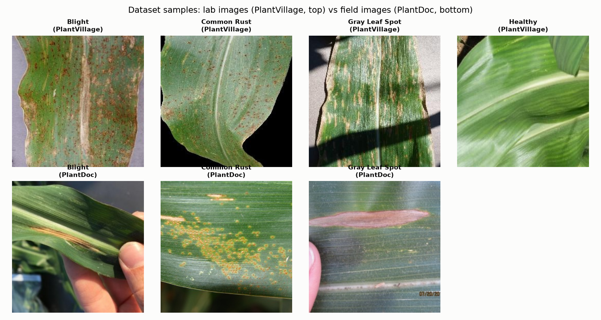
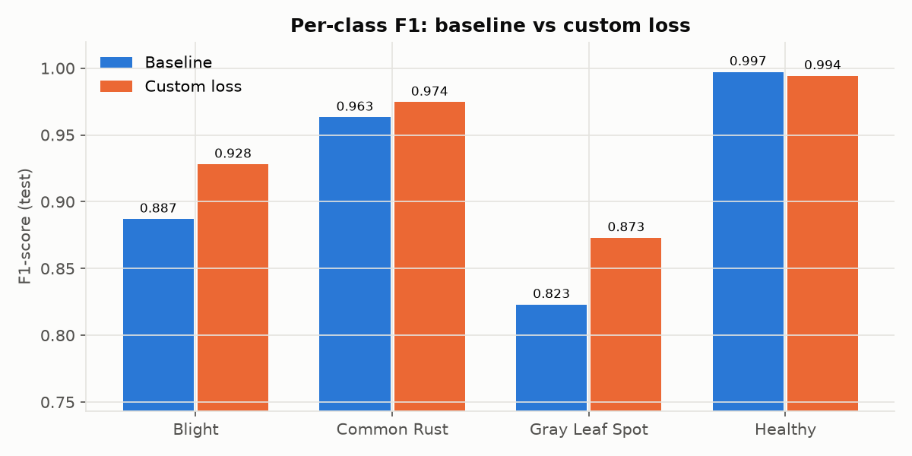
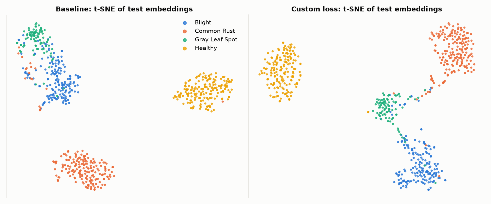
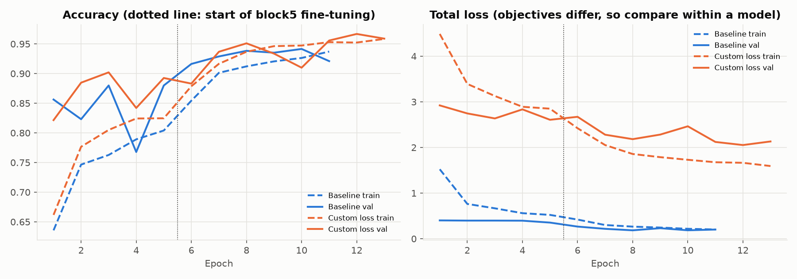
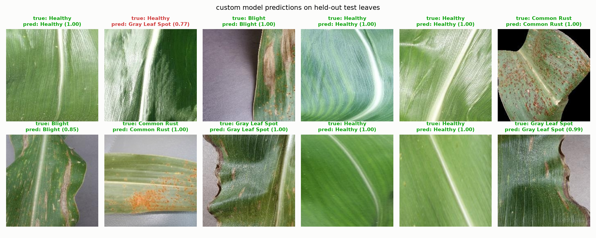

# VGG16 with Reinforcement-Learning-Inspired Loss for Corn Leaf Disease Classification

A **VGG16 transfer-learning** classifier for four corn (maize) leaf conditions: **Blight, Common Rust, Gray Leaf Spot and Healthy**. It is trained with a custom objective that combines:
1. a **reward/penalty-based (RL-inspired) expected-regret loss**, which heavily penalises the agronomically critical confusion **Blight ↔ Gray Leaf Spot**;
2. **embedding-based metric learning**: supervised contrastive loss with hard-negative weighting.

It is compared against an identical baseline VGG16 trained with ordinary cross-entropy, on the same test set.

`Python` · `TensorFlow 2.21 / Keras 3` · `VGG16` · `OpenCV` · `NumPy` · `scikit-learn`

| Model (same data, split, schedule, seed) | Test accuracy | Macro-F1 | Blight ↔ Gray Leaf Spot errors |
|---|---|---|---|
| Baseline VGG16 (weighted cross-entropy) | 93.04 % | 0.918 | 30 |
| **Custom-loss VGG16** | **95.25 %** | **0.942** | **18 (−40.0 %)** |

<p float="left">


</p>

## Interactive demo
```powershell
.\run_demo.bat              # or: streamlit run app.py   → http://localhost:8502
```
Classify a bundled held-out test leaf ([samples/](samples/), 8 images) or upload your own photo. The app shows the baseline and custom-loss probabilities side by side, plus the confusion matrices and embedding plots. If the trained models are missing, it offers to download them from the v1.0 release.

---

## 1. Problem statement
Northern Leaf Blight and Gray Leaf Spot both produce elongated grey-tan lesions and are easily confused, yet they call for different management (resistant hybrids, fungicide timing). A classifier that is "accurate on average" can still make exactly this costly mistake. The goal is high overall accuracy **and fewer critical Blight ↔ Gray Leaf Spot confusions**.

## 2. Objectives
1. Build a validated, licence-clean, **leakage-free** 4-class corn leaf dataset.
2. Fine-tune ImageNet VGG16 with augmentation and dropout.
3. Design a loss that encodes the different costs of mistakes (reward matrix) and separates the confusable classes in embedding space.
4. Compare against a baseline under identical conditions, with confidence intervals.

## 3. Dataset
Rebuilt from the two original sources of the Kaggle "Corn or Maize Leaf Disease Dataset". Details and licences are in [data/README.md](data/README.md).

| Class | PlantVillage (lab, CC BY-SA 3.0) | PlantDoc (field, CC BY 4.0) | Total | Train / Val / Test |
|---|---|---|---|---|
| Blight | 985 | 189 | 1,174 | 822 / 176 / 176 |
| Common Rust | 1,192 | 116 | 1,308 | 916 / 196 / 196 |
| Gray Leaf Spot | 513 | 67 | 580 | 406 / 87 / 87 |
| Healthy | 1,162 | 0 | 1,162 | 815 / 174 / 173 |
| **Total** | 3,852 | 372 | **4,224** | 2,959 / 633 / 632 |

**Validation and leakage control** (`scripts/acquire_data.py`):
- Every file is decoded with **OpenCV**. Images are resized (short side 256) and centre-cropped to 256×256.
- Exact pixel duplicates are removed. Three PlantDoc test images duplicated a train image under a *different* label (PlantDoc label noise, e.g. a file named `corn-gray-leaf-spot-f4.jpg` in the blight folder). The first copy is kept and the conflicting copy is dropped and logged.
- PlantVillage contains re-saved "copy" files of the same photo. These are grouped by original photo ID, and a **rotation/flip-invariant perceptual hash** merges further near-duplicates: 4,224 images → 3,373 groups.
- The split is **stratified by class and grouped**, so no group appears in two splits; the script asserts this. PlantVillage's published leaf-grouping map has no corn entries (checked: 0 of 40,328 keys), so these groups are the best available proxy.



## 4. Model
```
RGB 224×224 → VGG16 preprocessing (BGR, ImageNet mean) → VGG16 conv base (ImageNet)
→ GlobalAveragePooling → Dropout(0.5) → Dense(256, ReLU) → Dropout(0.5) → Dense(128) = embedding
      ├─ L2-normalise → "embedding" output (metric-learning loss)
      └─ ReLU → Dense(4, softmax) → "probs" output (classification loss)
```
- **Augmentation:** random 224 crop, horizontal and vertical flips, 90° rotations, brightness, contrast and saturation jitter.
- **Training:** stage 1 trains the head with VGG16 frozen (Adam 1e-3, 5 epochs). Stage 2 fine-tunes **block5** (Adam 5e-5, 8 epochs). Early stopping restores the best weights.
- **Class weights:** inverse frequency, applied in **both** models, so the comparison isolates the new loss terms.

## 5. The customized loss (`src/training/losses.py`)

$$\mathcal{L} = \underbrace{\mathrm{CE}_w(y,\pi)}_{\text{weighted CE}} \;+\; \lambda_R\,\underbrace{\Big(\max_a R_{y,a} - \sum_a \pi(a\mid x)\,R_{y,a}\Big)}_{\text{expected regret}} \;+\; \lambda_C\,\underbrace{\mathcal{L}_{\text{SupCon}}^{\text{hard-neg}}(z, y)}_{\text{metric learning}}$$

**Reward matrix** R: +1 for a correct diagnosis, −1 for an ordinary error, **−4 for Blight ↔ Gray Leaf Spot**. Weights: λ_R = 1, λ_C = 0.5.

### Why "reinforcement-learning-inspired", and why it is *not* RL
- The softmax output π(a | x) is treated as a **stochastic policy** over diagnoses. Each image is a one-step episode (a contextual bandit), and the reward matrix scores each action.
- The regret term maximises **expected reward** J(x) = Σₐ π(a|x)·R[y,a]. Its gradient with respect to the logits is π(a|x)(R[y,a] − J(x)), which is the **policy gradient with the expected reward as baseline**.
- Because the reward is known and there are only four actions, the expectation is computed **exactly** instead of by sampling (no REINFORCE variance).
- **What it is not:** there is no environment, no state transitions, no exploration and no temporal credit assignment. Mathematically it is **cost-sensitive (expected-risk) learning**, framed through RL's reward-maximisation view.

### Embedding metric learning
**Supervised contrastive loss** (Khosla et al., 2020) on L2-normalised 128-d embeddings, with temperature 0.1. Pairs of Blight and Gray Leaf Spot images get **3× weight in the contrastive denominator** (hard negatives), so the embedding space pushes exactly those two classes apart. The loss is unit-tested: critical confusions cost more, a perfect prediction has zero regret, and hard-negative weighting raises the penalty for similar Blight/GLS embeddings.

## 6. Results (test set: 632 images from held-out groups; actual measurements)

### 6.1 Overall
| Metric | Baseline | Custom loss |
|---|---|---|
| Accuracy | 93.04 % | **95.25 %** |
| Macro precision | 0.912 | **0.939** |
| Macro recall | 0.928 | **0.946** |
| Macro F1 | 0.918 | **0.942** |
| Blight → Gray Leaf Spot | 22 | **11** |
| Gray Leaf Spot → Blight | 8 | **7** |
| **Critical errors (total)** | 30 | **18** |
| Blight/GLS embedding silhouette | 0.338 | **0.527** |

**Paired bootstrap** (5,000 resamples of the test set):
- Critical-error reduction **40.0 %**, 95 % CI **[12.8 %, 62.5 %]**.
- Accuracy gain **+2.2 pp**, 95 % CI **[+0.5, +4.1] pp**.

These intervals capture test-set sampling only. Each model was trained once (seed 42), so training-run variance is **not** included.

### 6.2 Per class (test)
| Class | Baseline P / R / F1 | Custom P / R / F1 | Support |
|---|---|---|---|
| Blight | 0.905 / 0.869 / 0.887 | 0.942 / 0.915 / **0.928** | 176 |
| Common Rust | 0.995 / 0.934 / 0.963 | 0.975 / 0.975 / **0.975** | 196 |
| Gray Leaf Spot | 0.752 / 0.908 / 0.823 | 0.840 / 0.908 / **0.873** | 87 |
| Healthy | 0.994 / 1.000 / **0.997** | 1.000 / 0.988 / 0.994 | 173 |



### 6.3 Lab vs field images
| Source | Test images | Baseline | Custom |
|---|---|---|---|
| PlantVillage (lab, plain background) | 573 | 96.0 % | 97.2 % |
| PlantDoc (field, cluttered) | 59 | 64.4 % | 76.3 % |

Field photos are much harder. This gap is the main limitation for real-world use.

### 6.4 Embeddings, training curves, demo




Classification reports: [results/reports/](results/reports/). Per-image predictions: [results/metrics/test_predictions.csv](results/metrics/test_predictions.csv).

### 6.5 Comparison with the resume
| Resume claim | Reproduced |
|---|---|
| 95.22 % accuracy | **95.25 %** (custom loss) |
| 35.4 % fewer Blight ↔ GLS errors | **40.0 %** (30 → 18), 95 % CI 12.8–62.5 % |

The original files were lost. These are fresh measurements from this re-implementation on a leakage-controlled split.

## 7. Installation (Windows, VS Code)
```powershell
git clone https://github.com/Harishbala123/corn-disease-classification-vgg16.git
cd corn-disease-classification-vgg16
py -3.11 -m venv .venv
.\.venv\Scripts\Activate.ps1
pip install -r requirements.txt
```
Git must be installed (the acquisition script uses sparse clones). In VS Code: *Python: Select Interpreter → .venv*.

## 8. Execution
```powershell
python scripts/acquire_data.py                # download (~150 MB), validate, de-duplicate, split, summary graphs
python scripts/train.py --variant baseline    # ~60 min on a laptop CPU, a few min on a Colab T4
python scripts/train.py --variant custom      # ~80 min CPU
python scripts/evaluate.py                    # metrics, confusion matrices, bootstrap CIs, t-SNE, curves
python scripts/predict.py path\to\leaf.jpg    # single-image prediction (OpenCV)
python scripts/predict.py --demo              # prediction grid on held-out test leaves
python -m pytest -q                           # 8 unit tests
```
Trained weights (~57 MB each) are attached to the [v1.0 release](https://github.com/Harishbala123/corn-disease-classification-vgg16/releases/tag/v1.0). See [models/README.md](models/README.md).

**Google Colab (GPU):** [notebooks/colab_training.ipynb](notebooks/colab_training.ipynb) ([Open in Colab](https://colab.research.google.com/github/Harishbala123/corn-disease-classification-vgg16/blob/main/notebooks/colab_training.ipynb)) runs the same scripts. Native-Windows TensorFlow ≥ 2.11 has no GPU support, which is why the reported runs used the CPU and Colab is recommended for GPU training.

## 9. Folder structure
```
corn-disease-classification-vgg16/
├── configs/config.yaml               # classes, reward matrix, loss weights, schedule
├── data/README.md                    # sources, licences, mapping, validation (images not committed)
├── models/README.md                  # where to get the trained weights (GitHub release)
├── notebooks/colab_training.ipynb
├── results/{graphs,metrics,reports}
├── scripts/                          # acquire_data, train, evaluate, predict
├── src/
│   ├── data/        acquire.py (download, OpenCV validation), dedup.py (perceptual hash), split.py, pipeline.py (tf.data + augmentation)
│   ├── models/      vgg16_model.py
│   ├── training/    losses.py (weighted CE, RL-inspired regret, hard-negative SupCon), train.py
│   ├── evaluation/  evaluate.py
│   └── utils/       common.py, plotting.py, export.py
└── tests/test_corn.py
```

## 10. Limitations
- **Single training run per model.** Seed-to-seed variation could be comparable to the accuracy gap. Multiple seeds would strengthen the claim.
- The test set has only **87 Gray Leaf Spot** and **59 field images**, so the CIs are wide.
- PlantVillage images are lab photos on plain backgrounds. Field performance (76 %) is far below lab performance (97 %).
- No official leaf IDs exist for PlantVillage corn, so grouping uses photo IDs and perceptual hashes, a proxy.
- The reward values (−4 for the critical pair) were set by judgement, not tuned on test data. They are not derived from real economic costs.

## 11. Future improvements
- 3–5 seeds per model and an ablation (regret only vs SupCon only).
- More field images (PlantDoc, CD&S) and domain adaptation for field robustness.
- Grad-CAM explanations of the lesions the model focuses on.
- Lighter backbones (MobileNetV3/EfficientNet) for on-device use.

## 12. References
1. K. Simonyan, A. Zisserman. *Very Deep Convolutional Networks for Large-Scale Image Recognition.* ICLR 2015.
2. P. Khosla et al. *Supervised Contrastive Learning.* NeurIPS 2020.
3. R. J. Williams. *Simple statistical gradient-following algorithms for connectionist reinforcement learning.* Machine Learning 8, 1992.
4. C. Elkan. *The Foundations of Cost-Sensitive Learning.* IJCAI 2001.
5. D. Hughes, M. Salathé. *An open access repository of images on plant health…* arXiv:1511.08060, 2015. S. P. Mohanty et al. *Using Deep Learning for Image-Based Plant Disease Detection.* Front. Plant Sci. 7:1419, 2016.
6. D. Singh et al. *PlantDoc: A Dataset for Visual Plant Disease Detection.* CODS-COMAD 2020.

## License
Code: MIT (see [LICENSE](LICENSE)). Images: PlantVillage (CC BY-SA 3.0) and PlantDoc (CC BY 4.0), downloaded by script, not redistributed.
